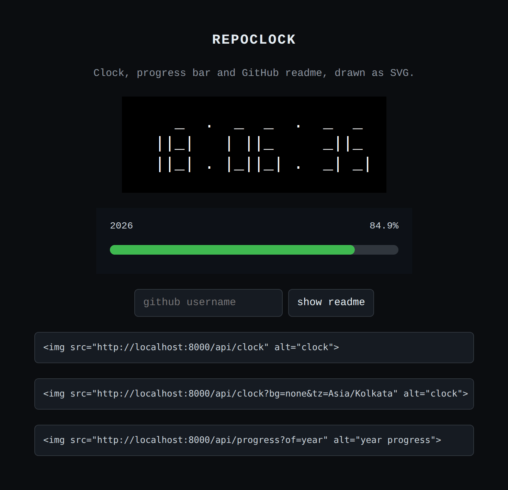

# repoclock

a small python server that makes svg images for your github readme:

- a clock
- a progress bar for the year, month, week, or day
- your github profile readme as plain text

## live

these two come from my hosted app:

## use it in your readme

copy an image link into your readme. use `https`, not `http`.

    

    

`bg=none` means no background. change `fg` so the text is visible on your page.
the clock is utc by default. add `?tz=Asia/Kolkata` for another timezone.

the readme image needs a repo with the same name as your username:

    

there are more options in [usage.md](docs/usage.md).

## run it yourself

you need python 3.9 or newer. nothing to install.

    python3 server.py

open http://localhost:8000. press ctrl+c to stop.

## put it online

you can host it on pythonanywhere for free. steps are in
[deploy-pythonanywhere.md](docs/deploy-pythonanywhere.md).

## endpoints

- `/api/clock` - clock
- `/api/progress` - progress bar
- `/api/intro?user=YOURNAME` - profile readme

that's it.
